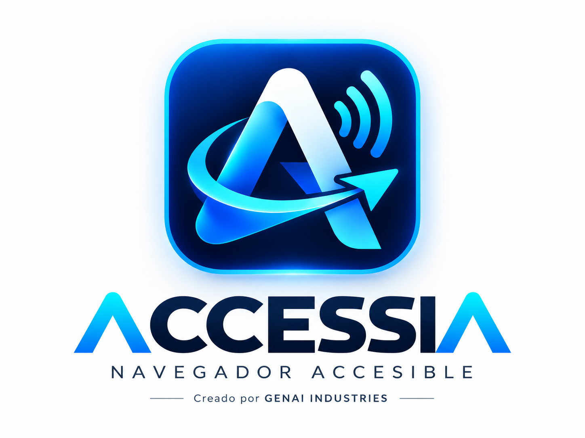
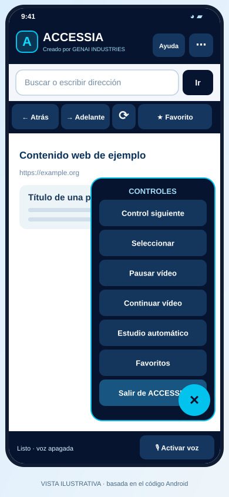

# ACCESSIA — Navegador Inteligente de Accesibilidad Universal

<p align="center">
  
</p>

<p align="center"><sub><strong>Creado por GENAI INDUSTRIES</strong> · <strong>Creador y propietario único: Luis Carlos Moreno Jiménez</strong> · Santa Cruz de la Sierra, Bolivia</sub></p>

**Creado por GENAI INDUSTRIES. Creador y propietario único: Luis Carlos Moreno Jiménez.** Santa Cruz de la Sierra, Bolivia.

**Proyecto público y gratuito · Código fuente MIT · Android + Windows · Español inicial**


## Estado verificado — 24 de octubre de 2026

| Área | Evidencia y situación |
|---|---|
| Código Android en revisión | [PR #2](https://github.com/luis171987/ACCESSIA/pull/2), rama `feat/accessia-v02-ui-voice`; última revisión funcional comprobada: [`b7a97fd`](https://github.com/luis171987/ACCESSIA/commit/b7a97fd34a9677041fc411d8decd72b98132d069). El PR permanece abierto. |
| Comentarios de revisión | **22 de 22 hilos respondidos y resueltos**. La revisión automática de `b7a97fd` terminó sin nuevos hallazgos. |
| Pruebas de esa revisión | **25 nativas Android, 12 JavaScript y 24 Python aprobadas: 61 en total.** Son resultados del código del PR, no una afirmación de que las funciones nuevas estén fusionadas en `main`. |
| Integración continua | [Android: pruebas y APK](https://github.com/luis171987/ACCESSIA/actions/runs/40056410475) y [JS/Python y escaneo](https://github.com/luis171987/ACCESSIA/actions/runs/40056410471) aprobados para `b7a97fd`. |
| Seguridad revisada | Escaneo del árbol de trabajo: **71 archivos de texto, cero hallazgos**. No equivale a auditar todo el historial ni a una revisión de seguridad completa. |
| Distribución publicada | Prelanzamiento [`v0.3.0-beta.3`](https://github.com/luis171987/ACCESSIA/releases/tag/v0.3.0-beta.3), publicado el 22 de octubre desde `e947910`: APK Android debug y ZIP portable Windows. |
| APK con las correcciones actuales | [Artefacto experimental de `b7a97fd`](https://github.com/luis171987/ACCESSIA/actions/runs/40056410475/artifacts/12546010778), generado por Actions. Es un ZIP que contiene el APK; puede requerir iniciar sesión y caduca según la retención de artefactos. |
| Fusión y validación física | **Pendientes.** La [incidencia #1](https://github.com/luis171987/ACCESSIA/issues/1) y el PR exigen probar la APK actual en **Honor Magic 7 Lite** antes de fusionar. La instalación reportada de una APK anterior no valida esta revisión. |

**[Informe de las correcciones y lista de pruebas físicas](https://github.com/luis171987/ACCESSIA/blob/b7a97fd34a9677041fc411d8decd72b98132d069/docs/REVISION_PR2_2026-10-24.md)** · [Estado y deuda de trabajo actualizados](docs/ESTADO_ACTUAL.md) · [Pendientes priorizados](#deuda-de-trabajo-y-siguientes-entregas). · [Guía de comandos de la revisión Android](https://github.com/luis171987/ACCESSIA/blob/b7a97fd34a9677041fc411d8decd72b98132d069/docs/GUIA_COMANDOS_ACCESSIA.md).

### Pausa de las pruebas en el Honor Magic 7 Lite

**La validación física permanece pendiente y pausada hasta contar con autorización expresa para reanudarla.** Las pruebas automatizadas no sustituyen la aceptación física; la instalación y las capturas requieren un procedimiento acordado y un dispositivo autorizado.

La sesión de trabajo no tiene una conexión de control autorizada con ese teléfono. La instalación y las pruebas quedan pendientes de ejecución manual guiada o de una conexión autorizada que se establezca posteriormente. **No se han documentado instalación, desinstalación ni pruebas físicas de esta revisión en el Honor.** Esta pausa corresponde al dispositivo de validación, no al acceso público al repositorio.


## 📥 Descargar ACCESSIA — instalación fácil

**No necesitas instalar GitHub, Termux ni herramientas de programación.** Abre el enlace de tu sistema operativo y descarga el archivo directamente desde la página oficial.

| Tu dispositivo | Descargar | Qué obtendrás |
|---|---|---|
| 📱 **Android 9 o posterior** | **[⬇️ Descargar ACCESSIA Beta 0.3 (.apk)](https://github.com/luis171987/ACCESSIA/releases/download/v0.3.0-beta.3/ACCESSIA-Android-Beta-0.3-DEBUG.apk)** | Aplicación experimental de 533 MB aprox.; abre el APK desde Descargas y sigue las instrucciones de Android. |
| 🖥️ **Windows 10/11 x64** | **[⬇️ Descargar ACCESSIA Windows portable (.zip)](https://github.com/luis171987/ACCESSIA/releases/download/v0.3.0-beta.3/ACCESSIA-Windows-Beta-portable.zip)** | Carpeta portable experimental: extrae **todo** el ZIP y abre `Accessia.Windows.exe`. No es instalador asistido. |

**Diferencia entre canales:** los enlaces directos de la tabla corresponden a la beta publicada `e947910`. Las correcciones de los 22 comentarios están en `b7a97fd` y se obtienen del [artefacto del PR #2](https://github.com/luis171987/ACCESSIA/actions/runs/40056410475/artifacts/12546010778); todavía esperan la prueba física y la fusión. La actualización de este README documenta el estado del proyecto y no publica una nueva versión binaria.

**[📦 Ver todas las versiones y archivos disponibles](https://github.com/luis171987/ACCESSIA/releases)** · **[📖 Tutorial paso a paso para Android y Windows](docs/GUIA_DESCARGA_E_INSTALACION.md)**

**Instalación en 3 pasos:** (1) descarga el APK de Android o ZIP de Windows; (2) en Android abre el APK y sigue el instalador; en Windows extrae el ZIP completo; (3) abre ACCESSIA. Si Android pide autorización para instalar desde el gestor de archivos, concédela solo para esta instalación y revócala después. En Windows podrías necesitar [**.NET 8 Desktop Runtime**](https://dotnet.microsoft.com/en-us/download/dotnet/8.0) y [**Microsoft Edge WebView2 Runtime**](https://developer.microsoft.com/en-us/microsoft-edge/webview2/consumer/).

> **Importante:** son versiones preliminares, sin firma de distribución de producción ni certificación de accesibilidad. La APK Android usa firma debug, que puede impedir actualizar una instalación anterior firmada de otra forma; **no la desinstales sin conservar tus datos**. El ZIP de Windows incluye un ejecutable, pero todavía no existe un instalador firmado `.exe` o `.msi` con asistente. No hay instaladores para iOS, macOS o Linux. Nunca confundas **Source code (zip)** con un instalador.

### 📣 Compartir ACCESSIA con su logotipo

Comparte esta dirección: **https://github.com/luis171987/ACCESSIA**. Para que **WhatsApp o Facebook** muestren el logotipo en la vista previa, el propietario debe subir la imagen oficial desde **GitHub → Settings → Social preview → Edit → Upload an image**; la imagen del README **no se utiliza automáticamente**. **[Abrir el logotipo original](https://raw.githubusercontent.com/luis171987/ACCESSIA/main/docs/assets/accessia-logo-oficial.png)** · [Tutorial para configurar la vista previa](docs/GUIA_DESCARGA_E_INSTALACION.md#cómo-hacer-que-aparezca-el-logotipo-al-compartir-el-repositorio). Algunas plataformas guardan versiones antiguas en caché.


> **Estado: prototipo experimental.** Hay una beta publicada y una revisión Android más reciente con pruebas automatizadas y APK compilada. La aceptación física y la fusión siguen pendientes según el estado verificado de arriba; no se certifica accesibilidad universal ni funcionamiento correcto en todos los dispositivos.

ACCESSIA pretende facilitar la educación y navegación a personas con discapacidad motora. La automatización **sustituye acciones físicas**, pero no decisiones académicas. No resuelve exámenes, no salta videos y no elude CAPTCHA, DRM ni reglas de las plataformas.

## Versiones, instaladores y archivo visual

Cada entrega conserva sus descargas, código, documentación y recursos visuales en el [archivo cronológico de versiones](docs/versiones/README.md).

| Publicación | Estado | Descargas e imágenes | Todos los archivos |
|---|---|---|---|
| [v0.3.0-beta.3 · 2026-10-22](docs/versiones/2026-10-22_v0.3.0-beta.3/README.md) | Beta experimental: Android debug y Windows portable; capturas reales pendientes. | [Instaladores por plataforma y galería de referencia](docs/versiones/2026-10-22_v0.3.0-beta.3/README.md) | [Índice de 69 archivos, assets y procedencia visual](docs/versiones/2026-10-22_v0.3.0-beta.3/archivos.json) |

Al publicarse una versión completa verificada, el seguimiento actualizará los enlaces de descarga y las vistas reales de la interfaz que estén disponibles. Las imágenes anteriores se conservan por fecha y versión con nombres correlativos; los instaladores grandes permanecen en Releases. Las ilustraciones se mantienen identificadas como tales. Las capturas del Honor siguen sujetas a la pausa de pruebas descrita arriba.


## 🖼️ Interfaz de ACCESSIA en Android

Las siguientes **vistas ilustrativas** reproducen los elementos de interfaz definidos en el código Kotlin de la Beta v0.2: inicio, controles flotantes y ayuda por voz. **No son capturas de pantalla tomadas de un teléfono**; la apariencia final puede variar según Android, la resolución y las voces instaladas.

<p align="center">
  
  
  
</p>

<p align="center"><sub>Inicio · Panel flotante · Guía de comandos</sub></p>

**[Ver implementación Android y avances de la Beta v0.2 (PR #2)](https://github.com/luis171987/ACCESSIA/pull/2)** · **[Consultar las imágenes de interfaz](docs/assets/)**

## 🌍 Voz natural, idiomas y traducción — actualización v0.3 en desarrollo

ACCESSIA está evolucionando para ser un navegador accesible **multilingüe** y admitir **dictado prolongado**. Las pruebas de campo evidencian que el reconocimiento por sesiones cortas puede truncar consultas y confundir palabras. La nueva rama de desarrollo incorpora un modo `Dictar +` para **acumular fragmentos en la barra de búsqueda y revisarlos antes de pulsar Ir**. La revisión `b7a97fd` ya compiló y aprobó las pruebas automatizadas en GitHub Actions; las pruebas físicas en el Honor siguen pendientes y están temporalmente pausadas.

**Idioma y localización:** al iniciar, se toma el idioma del dispositivo. El usuario puede seleccionar el idioma del reconocimiento y el idioma preferido que GeckoView solicita a las páginas, de una lista o mediante una etiqueta BCP 47. **Opcionalmente**, se ofrece una sugerencia aproximada por país de la IP pública, previa autorización expresa para consultar `ipapi.co`; no se persiste la IP y siempre puede rechazarse o cambiarse manualmente. **La IP no determina el idioma de una persona.**

**Traducción:** una opción permite elegir destino y, con confirmación, abrir la página mediante Google Traductor, que recibirá la URL. No usarla con páginas privadas o autenticadas; no todas las webs son traducibles. La traducción local e integrada, y la internacionalización **de todos los textos de la interfaz**, permanecen pendientes.

**Voz femenina humana, español latino:** seguimos evaluando proveedores, no se garantiza todavía una voz neuronal incluida. Entre las candidatas documentadas figuran `es-BO-SofiaNeural` y `es-MX-DaliaNeural` (Azure), y voces españolas de Piper para uso local; la elección final deberá comprobar calidad, licencias, privacidad y coste. No se incorporarán claves de proveedores al APK ni a GitHub.

**[Leer investigación, comparación de Vosk/sherpa-onnx/Piper, privacidad y plan de pruebas](https://github.com/luis171987/ACCESSIA/blob/feat/accessia-v02-ui-voice/docs/ACCESSIA_V03_VOZ_IDIOMAS_TRADUCCION.md)** · [Código en revisión (PR #2)](https://github.com/luis171987/ACCESSIA/pull/2).

## Acceso rápido y orden correlativo

| ID | Módulo | Carpeta técnica | Documentación/diagrama |
|---|---|---|---|
| M01 | Gestión, identidad y alcance | `docs/01-gobierno/` | [01 Identidad](docs/01-gobierno/01-identidad-y-licencia.md) |
| M02 | Motor compartido de accesibilidad | `shared/` | [D03 Navegación](docs/02-diagramas/03-navegacion-dom.md) |
| M03 | Cliente Android | `android/` | [D07 Plataformas](docs/02-diagramas/07-plataformas-y-datos.md) |
| M04 | Cliente Windows | `windows/` | [D07 Plataformas](docs/02-diagramas/07-plataformas-y-datos.md) |
| M05 | Pruebas y calidad | `shared/tests/`, `tools/tests/` | [D08 Integración continua](docs/02-diagramas/08-ci-cd-y-distribucion.md) |
| M06 | Seguridad, privacidad y publicación | `docs/03-seguridad/`, `tools/`, `.github/` | [D06 Credenciales](docs/02-diagramas/06-credenciales-y-privacidad.md) |

**[📚 ÍNDICE MAESTRO DE DOCUMENTOS Y 12 DIAGRAMAS](docs/00-INDICE-MAESTRO.md)** · [Mapa de carpetas](docs/01-gobierno/02-estructura-correlativa.md) · [Estado verificable](docs/ESTADO_ACTUAL.md) · [Guía de seguridad](docs/03-seguridad/01-credenciales-por-usuario.md).

Las carpetas técnicas conservan nombres estándar (`.github`, `android/app/src/main`, `windows/`, `shared/`) para no romper las herramientas de compilación; su orden correlativo se expresa con los identificadores **M01–M06** y con documentos **D01–D12**, no con renombres artificiales incompatibles.

## Características implementadas en el prototipo

- Motor JavaScript compartido `shared/accessia.js`: foco, selección, video HTML5, continuidad explícita limitada al documento y bloqueo ante evaluaciones o navegación ambigua.
- Android: fuente Kotlin/GeckoView, voz experimental en primer plano y controles accesibles. En el PR #2: dictado por fragmentos, ayuda y créditos hablados, selección de idioma/voz, favoritos e historial, panel flotante adaptable y apertura del documento elegido en el selector de Descargas.
- Correcciones del PR #2: sincronización de ambos micrófonos y TalkBack, reintentos limitados, descarte de callbacks de reconocedores detenidos, prioridad de hipótesis de transcripción, dominios conservados, envío con teclado, dictado nuevo sin arrastrar la URL y cierre del historial de navegación de la sesión. [Evidencia y alcance](https://github.com/luis171987/ACCESSIA/blob/b7a97fd34a9677041fc411d8decd72b98132d069/docs/REVISION_PR2_2026-10-24.md).
- Windows: fuente C#/WinForms/WebView2, reconocimiento de voz según motores disponibles, perfil del navegador separado por cuenta de Windows.
- Demo educativa y pruebas unitarias Node. **Los seis agentes especializados son roles de arquitectura, no seis modelos autónomos implementados.**

Comandos: `pausar`, `continuar`, `cursor siguiente`, `cursor anterior`, `seleccionar`, `activar estudio automático`, `desactivar estudio automático`, `cerrar página`, `cerrar navegador`, `acerca de` (créditos).

## Deuda de trabajo y siguientes entregas

Los 22 comentarios corregidos no representan el cierre de toda la hoja de ruta. Esta es la deuda revisada al 24 de octubre:

| ID / prioridad | Trabajo pendiente | Criterio para darlo por terminado |
|---|---|---|
| DT01 · Bloqueo actual | Acordar y autorizar la reanudación de la validación física pendiente. | Autorización expresa del responsable y procedimiento de instalación y pruebas acordado, preservando los datos de una versión previa. |
| DT02 · Alta | Validar la APK actual en Honor Magic 7 Lite y con accesibilidad real. | Registrar commit/APK, Android y motores STT/TTS; probar TalkBack, ambos micrófonos, letra ampliada y orientación horizontal, dictado, teclado, comandos, ayuda, idiomas, cierre de páginas y Descargas. [Lista detallada](https://github.com/luis171987/ACCESSIA/blob/b7a97fd34a9677041fc411d8decd72b98132d069/docs/REVISION_PR2_2026-10-24.md). |
| DT03 · Alta | Resolver la puerta de fusión del PR #2 y cerrar la incidencia #1 cuando corresponda. | DT02 documentado y satisfactorio, revisión y CI del commit que vaya a fusionarse aprobados. Los hilos resueltos y una compilación exitosa no sustituyen esa prueba. |
| DT04 · Alta | Medir voz, rendimiento y uso sin manos con personas usuarias. | Ensayos reproducibles de precisión y errores de intención, latencia, inicio, RAM/CPU, batería y datos. Las mediciones propuestas están en la [investigación de voz](https://github.com/luis171987/ACCESSIA/blob/b7a97fd34a9677041fc411d8decd72b98132d069/docs/ACCESSIA_V03_VOZ_IDIOMAS_TRADUCCION.md). |
| DT05 · Alta antes de distribución general | Firma y actualización de producción, revisión de seguridad/privacidad, dependencias y tamaño del paquete. | Definir firma segura sin publicar claves, probar actualizaciones que conserven datos, revisar SBOM/licencias, evaluar una versión estable de GeckoView y auditar la distribución. |
| DT06 · Media | Implementar descargas delegadas desde GeckoView. | Descargar y abrir archivos desde el navegador con permisos y errores accesibles; abrir el gestor del sistema o un documento existente es una función distinta. |
| DT07 · Media | Internacionalización completa, intenciones multilingües y traducción integrada. | Extraer y traducir todas las cadenas nativas, probar RTL y accesibilidad; validar idiomas de comandos y privacidad. El selector de idioma y el enlace a Google Traductor son la fase actual. |
| DT08 · Media | STT/VAD streaming, memoria contextual segura y evaluación de TTS neuronal latinoamericana. | Elegir modelos/proveedor tras pruebas, licencias, privacidad y costes; consentimiento y borrado para memoria opcional; credenciales fuera del APK y del repositorio. |
| DT09 · Media | Validación Windows y distribución con instalación asistida. | Pruebas físicas de WebView2/voz/accesibilidad y un instalador firmado con actualización comprobada. El ZIP portable publicado sigue siendo experimental. |

La documentación correlativa y las betas ya están publicadas en GitHub. La prioridad inmediata es **reanudar y documentar la validación física cuando exista autorización expresa**, seguida de evaluar la fusión; las mejoras de producto posteriores conservan su estado pendiente.


## Pruebas locales

```bash
node --test shared/tests/*.test.js
python3 -m unittest discover -s tools/tests -p 'test_*.py'
python3 tools/check_public_secrets.py
```

Las pruebas nativas se incorporaron en la rama del **PR #2**. Con JDK, SDK y Gradle configurados en esa rama:

```bash
cd android
gradle :app:testDebugUnitTest :app:assembleDebug --no-daemon
```

Los comandos se ejecutan en un entorno de desarrollo; la persona que solo quiera instalar la aplicación puede usar la descarga correspondiente cuando esté lista para hacerlo.

## Compilar

- **Android**: la configuración actual utiliza **AGP 9.4.0**, **Gradle 9.6.0**, **Kotlin 2.4.21**, **JDK 17**, plataforma **Android SDK 37.2** y **Build Tools 36.0.0**. `minSdk = 28` (Android 9), `targetSdk = 35`; GeckoView Nightly fijado en `160.0.20261013094244`. La [configuración de CI](.github/workflows/build-android.yml) y los archivos Gradle de la rama son la referencia verificable; `android/README.md` conserva instrucciones anteriores que deben contrastarse con ellos.
- **Windows**: Windows 10/11, .NET SDK 8, WebView2 Runtime; `dotnet build windows/Accessia.Windows/Accessia.Windows.csproj -c Release`. Consultar `windows/README.md`.
- **GitHub Actions**: `.github/workflows/` ejecuta pruebas y compilaciones de desarrollo. Un artefacto no equivale a instalador auditado o firmado.

## Cuentas, claves y privacidad

**ACCESSIA no incluye contraseñas, usuarios de demostración compartidos, claves SSH privadas ni tokens de acceso.** Cada persona usa sus propias cuentas de los sitios que visita; ACCESSIA no solicita la contraseña de GitHub del creador. Los perfiles web quedan bajo las protecciones de la cuenta del sistema operativo (no se promete aislamiento total frente a malware o un sistema comprometido).

NUNCA agregues `.env` real, `*.pem`, `*.key`, `id_rsa`, archivos de sesión, cookies, logs de autenticación ni certificados de firma al repositorio. Antes de publicar ejecuta `python3 tools/check_public_secrets.py`, inspecciona las diferencias y revisa GitHub secret scanning. Consulta [la política de credenciales](docs/03-seguridad/01-credenciales-por-usuario.md).

## Créditos y licencia

**ACCESSIA — creado por GENAI INDUSTRIES. Creador y propietario único: Luis Carlos Moreno Jiménez. Santa Cruz de la Sierra, Bolivia.** Código fuente licenciado bajo **MIT**: ver [LICENSE](LICENSE). MIT permite modificar, redistribuir e incluso comercializar derivados; el repositorio oficial se ofrece gratuitamente. La licencia del código no confiere por sí misma derechos de uso sobre la marca **GENAI INDUSTRIES** ni garantiza registro marcario. Las dependencias de terceros conservan sus propias licencias.

**Contacto y reportes de seguridad:** ver [SECURITY.md](SECURITY.md). No envíes contraseñas, capturas de cuentas ni datos personales en incidencias públicas.
