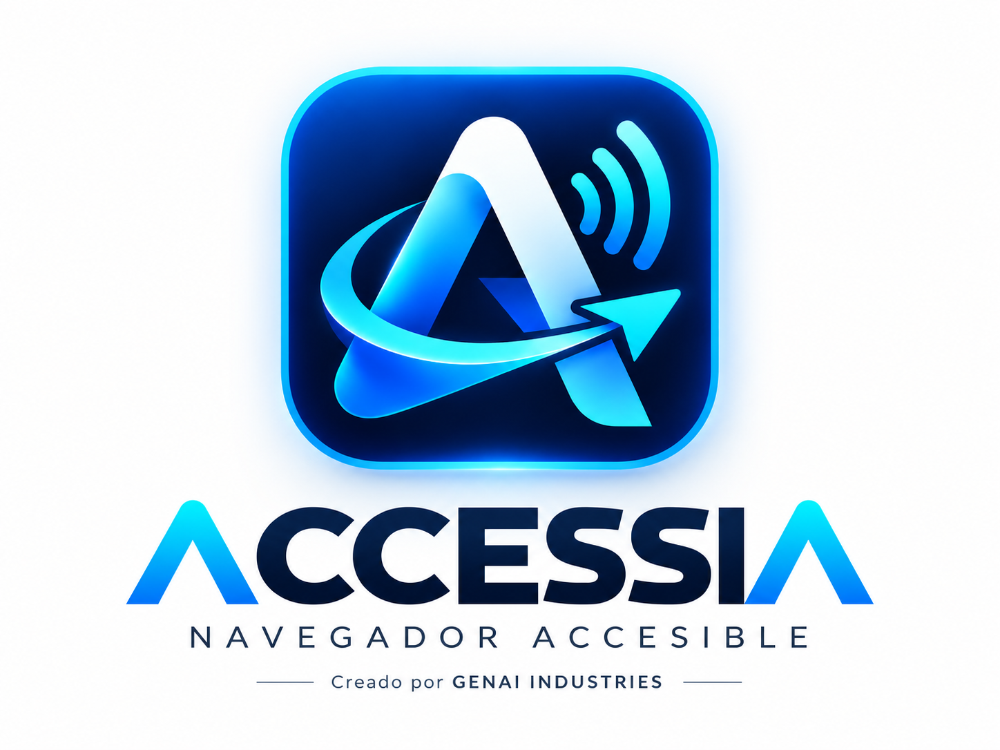
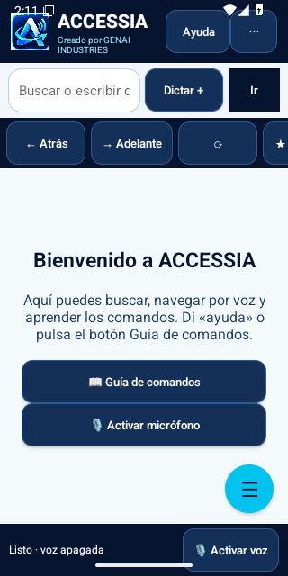
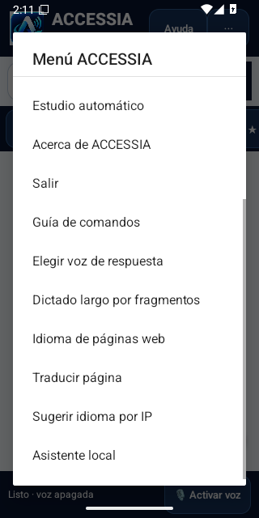
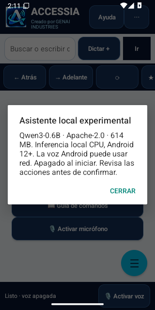

# ACCESSIA — Navegador Inteligente de Accesibilidad Universal

https://github.com/user-attachments/assets/b8aecb3b-311d-4151-b8ca-f3ce1a8bdcae

*Video de 3 minutos: simulación ilustrativa del prototipo. Las capturas de la guía inferior proceden de la aplicación ejecutada en un emulador Android.*

### [⬇️ Descargar ACCESSIA para Android — APK 0.3.0-dev, revisión 495e9ee](https://github.com/luis171987/ACCESSIA/releases/download/v0.3.0-preview.20261109/ACCESSIA-Android-0.3.0-dev-495e9ee-DEBUG.apk)

**Android 9 o posterior · APK experimental de 611 MB aprox. · Descarga directa del archivo `.apk`.** No necesitas GitHub, Termux ni herramientas de programación para instalarlo. [Procedencia y comprobación de la descarga](docs/PUBLICACION_VERIFICADA.md).

<p align="center">
  
</p>

**Creado por GENAI INDUSTRIES. Creador y propietario único: Luis Carlos Moreno Jiménez.** Santa Cruz de la Sierra, Bolivia.

ACCESSIA busca reducir acciones físicas repetidas al navegar y estudiar: permite abrir sitios, dictar búsquedas, recorrer controles y manejar vídeos compatibles mediante voz. El contenido y las decisiones siguen siendo tuyos.

## Instalar y empezar

1. Pulsa **Descargar ACCESSIA para Android** y espera a que termine la descarga del APK.
2. Abre el archivo desde **Descargas**. Si Android lo solicita, autoriza a ese gestor a instalar la aplicación y sigue el instalador; después puedes retirar esa autorización.
3. Abre **ACCESSIA Beta 0.3**. El paquete de esta revisión es `org.accessia.browser.beta03` y utiliza firma de desarrollo. Una instalación anterior con otra firma puede impedir actualizar: conserva tus datos antes de modificarla.

La versión es experimental y las pruebas físicas de aceptación siguen pendientes. El navegador requiere Android 9+; el motor del asistente local experimental requiere Android 12+ y un modelo adicional opcional. El APK contiene varias arquitecturas y todavía no está optimizado para distribución final.

## 1. Buscar, navegar y activar la voz



*Captura real de emulador Android 16 / API 36, revisión del PR #4 para `495e9ee`, obtenida el 25 de octubre de 2026.*

1. En **Buscar o escribir dirección**, escribe una dirección HTTPS o una consulta y pulsa **Ir**. También puedes enviar desde el teclado.
2. Usa **Atrás**, **Adelante** y **Recargar** para navegar. La barra de botones se puede desplazar horizontalmente para ver los demás controles.
3. Para una consulta larga, pulsa **Dictar +**. Revisa los fragmentos acumulados en la barra y envía la consulta cuando esté correcta.
4. Pulsa **Activar micrófono** en la bienvenida o **Activar voz** en la barra inferior y concede el permiso de micrófono cuando Android lo solicite. Espera el estado **Escuchando** antes de hablar.
5. Di, por ejemplo, «abrir wikipedia.org», «buscar universidades de Santa Cruz con becas», «atrás» o «recargar». El reconocimiento necesita un motor Android disponible y puede utilizar Internet según su proveedor.
6. El botón **Ayuda**, **Guía de comandos** o la orden «ayuda» muestran las funciones. El botón flotante **☰** despliega controles accesibles. La escucha funciona con ACCESSIA visible y puede detenerse con «desactivar voz».

## 2. Controles, idiomas y continuidad de estudio



*El menú de la captura está desplazado. Deslízalo para encontrar también Favoritos, Historial y Descargas.*

1. Abre **⋯**. En **Idioma para escuchar**, selecciona el idioma del reconocimiento. En **Elegir voz de respuesta**, elige y prueba una voz instalada compatible; su disponibilidad depende del dispositivo.
2. Guarda una página HTTPS con **★ Favorito** o «guardar en favoritos». Abre **Favoritos** para volver a ella. **Historial** permite consultar visitas y pide confirmación antes de borrarlas.
3. En una página compatible, di **«cursor siguiente»**, **«cursor anterior»** y **«seleccionar»** para mover el foco y activar el control elegido.
4. Con un vídeo HTML5 compatible, di **«pausar»** para detenerlo y **«continuar»** para reanudarlo.
5. En **Estudio automático**, confirma el permiso para la página actual. ACCESSIA solo puede avanzar cuando termina un vídeo y existe un único siguiente válido. Una navegación nueva requiere una autorización nueva. Las evaluaciones y los controles ambiguos bloquean el avance.
6. **Descargas** abre el gestor de Android y permite consultar documentos existentes. La descarga completa de contenidos desde GeckoView continúa pendiente.
7. **Idioma de páginas web** cambia la preferencia solicitada a los sitios. **Traducir página** abre Google Traductor tras confirmar el envío de la URL; no lo uses con páginas privadas o autenticadas. **Sugerir idioma por IP** es opcional y consulta un servicio externo solo si lo autorizas.
8. Para terminar, desactiva el micrófono y elige **Salir** o di «cerrar navegador». «Cerrar página» vuelve a la portada.

La locución femenina del vídeo se produce para esta presentación. La voz que responde dentro de la aplicación se selecciona entre las voces instaladas en Android; el vídeo no instala esa voz en el teléfono.

## 3. Vista previa del asistente local experimental



1. En **⋯ → Asistente local** se abre el panel informativo mostrado arriba. Esta captura verifica la apertura del panel; no demuestra la descarga del modelo ni una inferencia real en el emulador.
2. El código incluye un motor local opcional, apagado al iniciar, con un modelo de aproximadamente **614 MB**. Su descarga, activación y uso por dispositivo siguen en aceptación; no son necesarios para la navegación básica ni para los comandos de voz del sistema.

La revisión del asistente permanece en el **PR #4, en borrador**. El flujo de descarga y activación debe comprobarse antes de presentarlo como una función terminada: en las capturas disponibles se ve el cuadro informativo. Consulta el [alcance, privacidad y limitaciones de esta revisión](https://github.com/luis171987/ACCESSIA/blob/495e9ee6a4ae9a04122e0a8ff172f506a86661be/docs/AGENTE_LOCAL_EXPERIMENTAL.md). No necesita una suscripción de IA ni una clave de proveedor para su motor local; puede cometer errores y las acciones de navegación propuestas necesitan confirmación.

## Versión y evidencias de esta guía

Estado contrastado el **8 de noviembre de 2026**. La fecha de esta documentación no representa una nueva compilación del APK.

| Elemento | Referencia verificable |
|---|---|
| APK y código de la guía | `0.3.0-dev`, revisión [`495e9ee`](https://github.com/luis171987/ACCESSIA/commit/495e9ee6a4ae9a04122e0a8ff172f506a86661be), PR #4 en borrador. |
| Origen del APK | [Compilación Android de Actions, 25 de octubre](https://github.com/luis171987/ACCESSIA/actions/runs/40153274595). Se conserva el APK original, sin recompilar ni cambiar su firma. |
| Integridad del APK | SHA-256 `2d0096bd7d2ff5dd8c0467c880af241c23aa234fb9314410230f94a69049ea09`; 610.592.865 bytes; firma Android APK v2 verificada, certificado debug. |
| Capturas reales | [Pruebas virtuales Android / Windows](https://github.com/luis171987/ACCESSIA/actions/runs/40153274615), para el mismo head del PR. Las tres imágenes mostradas corresponden a API 36 x86_64. |
| Revisión de navegación y voz | [PR #2](https://github.com/luis171987/ACCESSIA/pull/2), revisión `6c9316d`, con compilación Android y pruebas automáticas aprobadas. |
| Integración del código | Los PR #2 y #4 conservan su estado de revisión. Publicar documentación o un APK experimental no equivale a fusionarlos en `main`. |
| Aceptación física | Pendiente y pausada. No se efectuaron instalaciones ni pruebas en un teléfono físico para esta entrega. |

El vídeo es una simulación del prototipo. Las capturas de esta guía son de un emulador ejecutando la aplicación. Ninguna de esas evidencias certifica accesibilidad universal, el rendimiento de todos los dispositivos ni una versión de producción.

## Versiones anteriores y Windows

| Canal | Descarga y alcance |
|---|---|
| Beta Android anterior, 22 de octubre | [APK de `v0.3.0-beta.3`](https://github.com/luis171987/ACCESSIA/releases/download/v0.3.0-beta.3/ACCESSIA-Android-Beta-0.3-DEBUG.apk), fuente `e947910`. Se conserva como versión histórica; no es el APK de la guía actual. |
| Windows portable experimental publicado | [Descargar ZIP de Windows](https://github.com/luis171987/ACCESSIA/releases/download/v0.3.0-beta.3/ACCESSIA-Windows-Beta-portable.zip). Extrae todo el ZIP y abre `Accessia.Windows.exe`; requiere Windows x64, .NET 8 Desktop Runtime y WebView2. No es un instalador asistido ni incorpora automáticamente las revisiones del PR #4. |

[Todas las versiones](https://github.com/luis171987/ACCESSIA/releases) · [Archivo visual cronológico](docs/versiones/README.md) · [Guía anterior de instalación por plataforma](docs/GUIA_DESCARGA_E_INSTALACION.md).

Las ilustraciones SVG anteriores y sus versiones se conservan en el archivo histórico. La galería actual usa las capturas reales identificadas arriba. El código fuente utiliza licencia MIT; las dependencias y recursos conservan sus propias licencias.

## Acceso rápido y orden correlativo

| ID | Módulo | Carpeta técnica | Documentación/diagrama |
|---|---|---|---|
| M01 | Gestión, identidad y alcance | `docs/01-gobierno/` | [01 Identidad](docs/01-gobierno/01-identidad-y-licencia.md) |
| M02 | Motor compartido de accesibilidad | `shared/` | [D03 Navegación](docs/02-diagramas/03-navegacion-dom.md) |
| M03 | Cliente Android | `android/` | [D07 Plataformas](docs/02-diagramas/07-plataformas-y-datos.md) |
| M04 | Cliente Windows | `windows/` | [D07 Plataformas](docs/02-diagramas/07-plataformas-y-datos.md) |
| M05 | Pruebas y calidad | `shared/tests/`, `tools/tests/` | [D08 Integración continua](docs/02-diagramas/08-ci-cd-y-distribucion.md) |
| M06 | Seguridad, privacidad y publicación | `docs/03-seguridad/`, `tools/`, `.github/` | [D06 Credenciales](docs/02-diagramas/06-credenciales-y-privacidad.md) |

**[📚 ÍNDICE MAESTRO DE DOCUMENTOS Y 12 DIAGRAMAS](docs/00-INDICE-MAESTRO.md)** · [Mapa de carpetas](docs/01-gobierno/02-estructura-correlativa.md) · [Estado verificable](docs/ESTADO_ACTUAL.md) · [Guía de seguridad](docs/03-seguridad/01-credenciales-por-usuario.md).

Las carpetas técnicas conservan nombres estándar (`.github`, `android/app/src/main`, `windows/`, `shared/`) para no romper las herramientas de compilación; su orden correlativo se expresa con los identificadores **M01–M06** y con documentos **D01–D12**, no con renombres artificiales incompatibles.


## Características y alcance del prototipo

- Navegación Kotlin/GeckoView en Android y C#/WinForms/WebView2 en Windows.
- Foco y selección, controles de vídeo HTML5, continuidad educativa por documento y bloqueo ante evaluaciones o ambigüedad.
- Voz del sistema en primer plano, dictado por fragmentos, ayuda, idiomas y voces instaladas, favoritos e historial, panel flotante adaptable y acceso al gestor de Descargas en la revisión Android.
- Asistente local opcional en revisión, con herramientas limitadas y confirmación para acciones. Los seis roles de la arquitectura no equivalen a seis modelos autónomos implementados.
- El reconocimiento de voz y la traducción pueden usar servicios externos. La traducción local integrada, la localización completa y la distribución de producción continúan pendientes.

## Deuda de trabajo y siguientes entregas

Se conservan DT01–DT09; las pruebas físicas y la integración de las revisiones siguen pendientes:

| ID / prioridad | Trabajo pendiente | Criterio para darlo por terminado |
|---|---|---|
| DT01 · Bloqueo actual | Acordar y autorizar la reanudación de la validación física pendiente. | Autorización expresa del responsable y procedimiento de instalación y pruebas acordado, preservando los datos de una versión previa. |
| DT02 · Alta | Validar la APK actual en Honor Magic 7 Lite y con accesibilidad real. | Registrar commit/APK, Android y motores STT/TTS; probar TalkBack, ambos micrófonos, letra ampliada y orientación horizontal, dictado, teclado, comandos, ayuda, idiomas, cierre de páginas y Descargas. [Lista detallada](https://github.com/luis171987/ACCESSIA/blob/b7a97fd34a9677041fc411d8decd72b98132d069/docs/REVISION_PR2_2026-10-24.md). |
| DT03 · Alta | Resolver la puerta de fusión del PR #2 y cerrar la incidencia #1 cuando corresponda. | DT02 documentado y satisfactorio, revisión y CI del commit que vaya a fusionarse aprobados. Los hilos resueltos y una compilación exitosa no sustituyen esa prueba. |
| DT04 · Alta | Medir voz, rendimiento y uso sin manos con personas usuarias. | Ensayos reproducibles de precisión y errores de intención, latencia, inicio, RAM/CPU, batería y datos. Las mediciones propuestas están en la [investigación de voz](https://github.com/luis171987/ACCESSIA/blob/b7a97fd34a9677041fc411d8decd72b98132d069/docs/ACCESSIA_V03_VOZ_IDIOMAS_TRADUCCION.md). |
| DT05 · Alta antes de distribución general | Firma y actualización de producción, revisión de seguridad/privacidad, dependencias y tamaño del paquete. | Definir firma segura sin publicar claves, probar actualizaciones que conserven datos, revisar SBOM/licencias, evaluar una versión estable de GeckoView y auditar la distribución. |
| DT06 · Media | Implementar descargas delegadas desde GeckoView. | Descargar y abrir archivos desde el navegador con permisos y errores accesibles; abrir el gestor del sistema o un documento existente es una función distinta. |
| DT07 · Media | Internacionalización completa, intenciones multilingües y traducción integrada. | Extraer y traducir todas las cadenas nativas, probar RTL y accesibilidad; validar idiomas de comandos y privacidad. El selector de idioma y el enlace a Google Traductor son la fase actual. |
| DT08 · Media | STT/VAD streaming, memoria contextual segura y evaluación de TTS neuronal latinoamericana. | Elegir modelos/proveedor tras pruebas, licencias, privacidad y costes; consentimiento y borrado para memoria opcional; credenciales fuera del APK y del repositorio. |
| DT09 · Media | Validación Windows y distribución con instalación asistida. | Pruebas físicas de WebView2/voz/accesibilidad y un instalador firmado con actualización comprobada. El ZIP portable publicado sigue siendo experimental. |

La documentación correlativa y las betas ya están publicadas en GitHub. La prioridad inmediata es **reanudar y documentar la validación física cuando exista autorización expresa**, seguida de evaluar la fusión; las mejoras de producto posteriores conservan su estado pendiente.


## Pruebas locales

```bash
node --test shared/tests/*.test.js
python3 -m unittest discover -s tools/tests -p 'test_*.py'
python3 tools/check_public_secrets.py
```

Para reproducir el APK documentado, utiliza la revisión `495e9ee` del PR #4; el código de `main` conserva su propia historia. Con JDK, SDK y Gradle configurados en esa rama:

```bash
cd android
gradle :app:testDebugUnitTest :app:assembleDebug --no-daemon
```

Los comandos se ejecutan en un entorno de desarrollo; la persona que solo quiera instalar la aplicación puede usar la descarga correspondiente cuando esté lista para hacerlo.

## Compilar

- **Android**: la configuración actual utiliza **AGP 9.4.0**, **Gradle 9.6.0**, **Kotlin 2.4.21**, **JDK 17**, plataforma **Android SDK 37.2** y **Build Tools 36.0.0**. `minSdk = 28` (Android 9), `targetSdk = 35`; GeckoView Nightly fijado en `160.0.20261013094244`. La [configuración de CI](.github/workflows/build-android.yml) y los archivos Gradle de la rama son la referencia verificable; `android/README.md` conserva instrucciones anteriores que deben contrastarse con ellos.
- **Windows**: Windows 10/11, .NET SDK 8, WebView2 Runtime; `dotnet build windows/Accessia.Windows/Accessia.Windows.csproj -c Release`. Consultar `windows/README.md`.
- **GitHub Actions**: `.github/workflows/` ejecuta pruebas y compilaciones de desarrollo. Un artefacto no equivale a instalador auditado o firmado.


## Cuentas, claves y privacidad

**ACCESSIA no incluye contraseñas, usuarios de demostración compartidos, claves SSH privadas ni tokens de acceso.** Cada persona usa sus propias cuentas de los sitios que visita; ACCESSIA no solicita la contraseña de GitHub del creador. Los perfiles web quedan bajo las protecciones de la cuenta del sistema operativo (no se promete aislamiento total frente a malware o un sistema comprometido).

NUNCA agregues `.env` real, `*.pem`, `*.key`, `id_rsa`, archivos de sesión, cookies, logs de autenticación ni certificados de firma al repositorio. Antes de publicar ejecuta `python3 tools/check_public_secrets.py`, inspecciona las diferencias y revisa GitHub secret scanning. Consulta [la política de credenciales](docs/03-seguridad/01-credenciales-por-usuario.md).


## Créditos y licencia

**ACCESSIA — creado por GENAI INDUSTRIES. Creador y propietario único: Luis Carlos Moreno Jiménez. Santa Cruz de la Sierra, Bolivia.** Código fuente licenciado bajo **MIT**: ver [LICENSE](LICENSE). MIT permite modificar, redistribuir e incluso comercializar derivados; el repositorio oficial se ofrece gratuitamente. La licencia del código no confiere por sí misma derechos de uso sobre la marca **GENAI INDUSTRIES** ni garantiza registro marcario. Las dependencias de terceros conservan sus propias licencias.

**Contacto y reportes de seguridad:** ver [SECURITY.md](SECURITY.md). No envíes contraseñas, capturas de cuentas ni datos personales en incidencias públicas.

