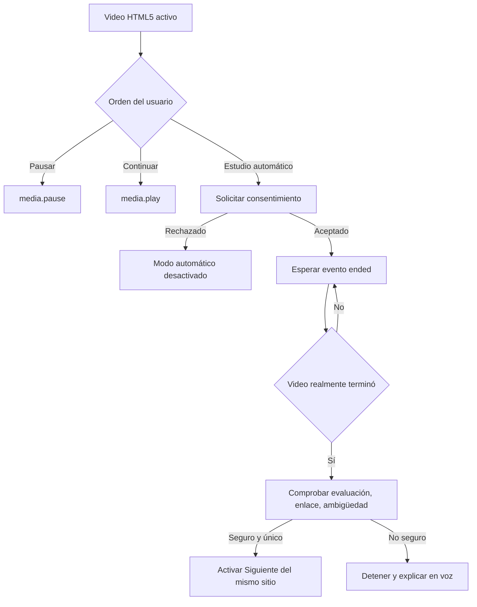

# D04 — Video y continuidad educativa

**ACCESSIA · GENAI INDUSTRIES · Luis Carlos Moreno Jiménez · Santa Cruz de la Sierra, Bolivia**
**Formato:** Mermaid editable. **Estado:** diseño / prototipo; no garantiza que todas las rutas estén implementadas o validadas.
[Volver al índice maestro](../00-INDICE-MAESTRO.md)

Consulte [la matriz de trazabilidad](../01-gobierno/03-matriz-trazabilidad.md) para identificar archivos, pruebas y brechas entre diseño e implementación.
