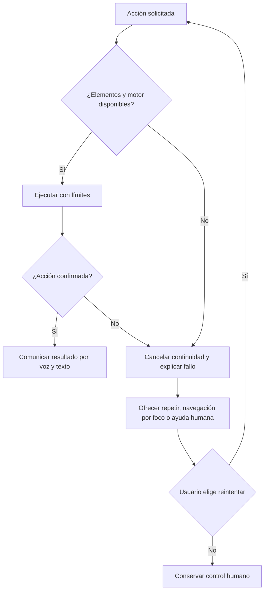

# D09 — Errores y recuperación accesible

**ACCESSIA · GENAI INDUSTRIES · Luis Carlos Moreno Jiménez · Santa Cruz de la Sierra, Bolivia**
**Formato:** Mermaid editable. **Estado:** diseño / prototipo; no garantiza que todas las rutas estén implementadas o validadas.
[Volver al índice maestro](../00-INDICE-MAESTRO.md)

Consulte [la matriz de trazabilidad](../01-gobierno/03-matriz-trazabilidad.md) para identificar archivos, pruebas y brechas entre diseño e implementación.

## Android: revisión del 24 de octubre de 2026

Las excepciones al iniciar el reconocedor y los errores recibidos por callback cuentan para el mismo límite de ocho fallos consecutivos. La detención limpia el dictado, sincroniza ambos botones de micrófono y anuncia el motivo a los servicios de accesibilidad. Los resultados tardíos recibidos con voz apagada se descartan. El envío con teclado y con Ir comparte la finalización del dictado y libera el foco de la dirección.

Pruebas nativas: `MainActivityReviewTest`. [Informe y pruebas físicas pendientes](../REVISION_PR2_2026-10-24.md).
