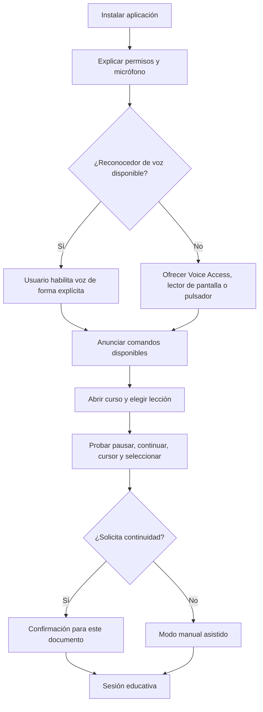

# D11 — Primer uso y acceso sin manos

**ACCESSIA · GENAI INDUSTRIES · Luis Carlos Moreno Jiménez · Santa Cruz de la Sierra, Bolivia**
**Formato:** Mermaid editable. **Estado:** diseño / prototipo; no garantiza que todas las rutas estén implementadas o validadas.
[Volver al índice maestro](../00-INDICE-MAESTRO.md)

Consulte [la matriz de trazabilidad](../01-gobierno/03-matriz-trazabilidad.md) para identificar archivos, pruebas y brechas entre diseño e implementación.

## Android: revisión del 24 de octubre de 2026

Los micrófonos de bienvenida y de la barra inferior comparten texto y descripción accesible. Menú y recarga tienen nombres semánticos. El panel flotante se coloca sobre la barra de voz, permite desplazamiento en ventanas cortas y restablece su etiqueta al ocultarse. Los créditos pedidos por voz se anuncian sin abrir un diálogo; la selección de voces conserva su lista visible.

El cambio manual de idioma y la aceptación de la sugerencia por país reconfiguran el mismo motor TTS. Las pruebas automatizadas de Android no sustituyen las [comprobaciones físicas con TalkBack y Honor Magic 7 Lite](../REVISION_PR2_2026-10-24.md).
