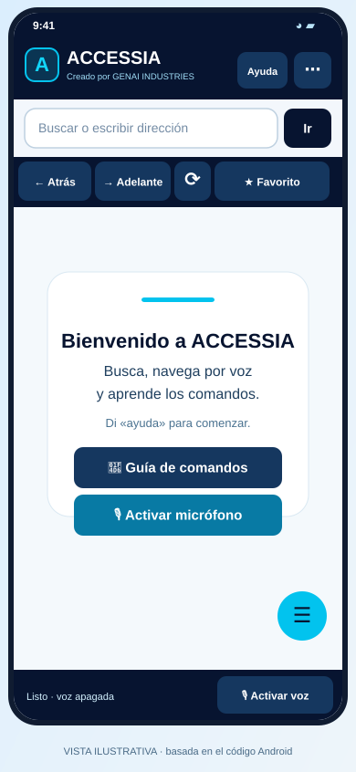
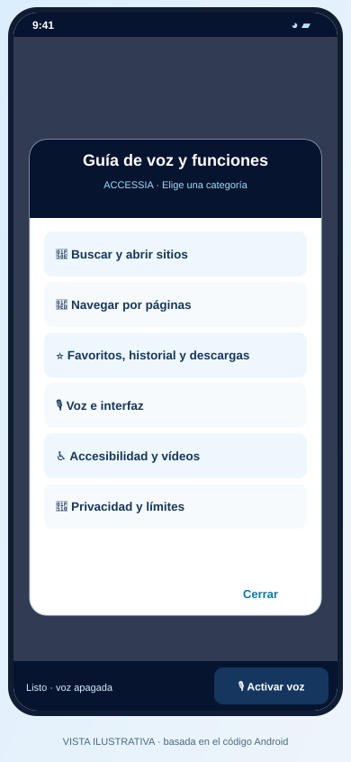

# ACCESSIA v0.3.0-beta.3 — 22 de octubre de 2026

**Creado por GENAI INDUSTRIES · Luis Carlos Moreno Jiménez.**

**Estado: prelanzamiento experimental.** Android usa firma debug; Windows se distribuye en un ZIP portable. Esta entrega corresponde al commit [`e947910`](https://github.com/luis171987/ACCESSIA/commit/e94791053ef43b61e09e3d07dee7ffc68b69dc2f). No incluye por sí misma las correcciones posteriores del [PR #2](https://github.com/luis171987/ACCESSIA/pull/2).

## Descarga por plataforma

| Plataforma | Archivo publicado | Tipo y requisitos |
|---|---|---|
| Android 9+ | [Descargar ACCESSIA Android Beta 0.3 (.apk)](https://github.com/luis171987/ACCESSIA/releases/download/v0.3.0-beta.3/ACCESSIA-Android-Beta-0.3-DEBUG.apk) | APK debug, aproximadamente 533 MiB. La firma puede impedir actualizar otra instalación; conservar los datos antes de considerar desinstalar. |
| Windows 10/11 x64 | [Descargar ACCESSIA Windows Beta portable (.zip)](https://github.com/luis171987/ACCESSIA/releases/download/v0.3.0-beta.3/ACCESSIA-Windows-Beta-portable.zip) | Extraer todo el ZIP y abrir `Accessia.Windows.exe`. Puede requerir .NET 8 Desktop Runtime y WebView2. No es un instalador asistido firmado. |

[Ver la publicación y sus archivos](https://github.com/luis171987/ACCESSIA/releases/tag/v0.3.0-beta.3). No hay instaladores publicados de esta entrega para iOS, macOS o Linux.

## Archivos completos de esta revisión

- [Ver los 69 archivos fuente/documentales en GitHub](https://github.com/luis171987/ACCESSIA/tree/e94791053ef43b61e09e3d07dee7ffc68b69dc2f).
- [Descargar el código completo (.zip)](https://github.com/luis171987/ACCESSIA/archive/e94791053ef43b61e09e3d07dee7ffc68b69dc2f.zip) o [(.tar.gz)](https://github.com/luis171987/ACCESSIA/archive/e94791053ef43b61e09e3d07dee7ffc68b69dc2f.tar.gz): son archivos de código fuente, no instaladores.
- [Manifiesto de archivos, instaladores y recursos visuales](archivos.json): rutas, tamaños y blobs Git de los 69 archivos de la revisión, más los assets publicados y la procedencia de las imágenes archivadas.

## Galería de referencia conservada

Las siguientes son **ilustraciones de la interfaz v0.2 incluidas en el árbol de esta entrega**. Se conservan sin redibujar y con los mismos blobs Git que sus originales. **No son capturas reales de Android ni de Windows y no representan una nueva validación física.**

  
  
  

Recursos de identidad archivados: [logotipo oficial](imagenes/identidad/00-logo-oficial.png) · [icono Android](imagenes/identidad/01-icono-android.webp).

## Capturas reales pendientes

| Plataforma | Vistas que deben documentarse | Situación |
|---|---|---|
| Android | Inicio, navegación o flujo principal, voz/opciones y accesibilidad, si esas pantallas existen en la versión ejecutada. | Sin capturas verificadas. Pruebas físicas pausadas hasta autorización expresa. |
| Windows | Inicio, navegación o flujo principal y opciones, según la interfaz real. | Sin capturas verificadas de esta entrega. |

La instalación, desinstalación y captura en un dispositivo físico requieren autorización expresa. No hay una conexión de control autorizada con un dispositivo físico disponible en esta sesión.

[Volver al archivo de versiones](../README.md) · [Estado actual del proyecto](../../../README.md).
